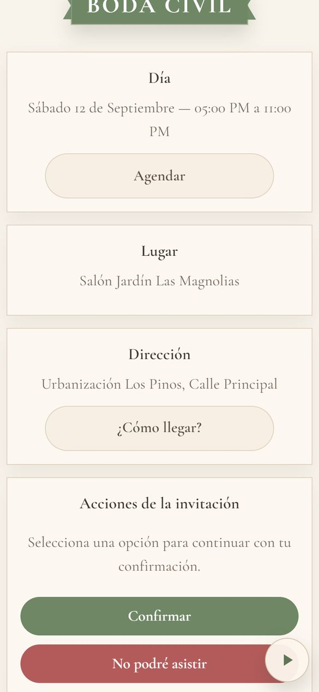
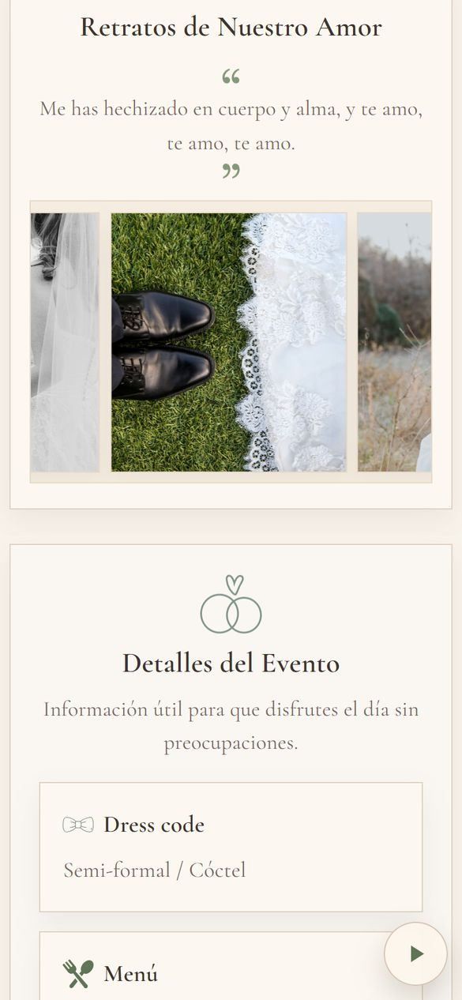
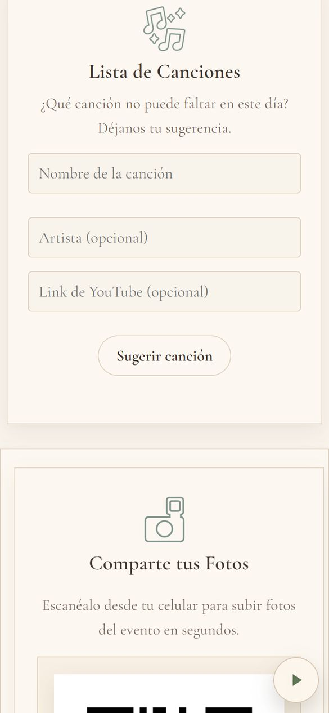

# wedding-invitation

A mobile-first wedding invitation with token-based RSVP and a host dashboard, built with Astro.

This is the public **demo** of a real invitation I built: the names, places, accounts and photos of the real event were replaced with fictional data, and the backend is stubbed so it runs without Firebase.

**Live demo:** [wedding-invitation-seven-brown.vercel.app](https://wedding-invitation-seven-brown.vercel.app) · **Case study:** [diegorangel.dev/en/projects/wedding-invitation](https://www.diegorangel.dev/en/projects/wedding-invitation)

<table>
  <tr>
    <td></td>
    <td></td>
    <td></td>
    <td></td>
  </tr>
</table>

## Try it

1. Open the [demo](https://wedding-invitation-seven-brown.vercel.app) on your phone and enter the access code **`DEMO123`**.
2. Confirm or decline attendance for the guests on that invitation.
3. Open the [host dashboard](https://wedding-invitation-seven-brown.vercel.app/anfitrion) with user **`demo`** and password **`wedding-demo`**.

The demo credentials are public on purpose: the dashboard only manages demo data.

## Features

- **Private access by token.** Each invitation has its own code; guests RSVP without creating an account.
- **RSVP per group.** An invitation lists who is included and how many people can attend, and guests confirm or decline for the group.
- **Host dashboard.** Manage invitations, see confirmations, review song requests and moderate shared photos.
- **Event day tools.** Countdown, add-to-calendar, directions, dress code, gift details, song requests and a QR code for guests to upload their photos.
- **Mobile-first.** Designed for the phone where guests open the link, with optional background music.

## Stack

Astro 5 and TypeScript, plain CSS, and Firebase (Firestore, Storage and security rules) in the real version. In this demo the Firebase calls are replaced by local stubs.

## Run locally

```bash
pnpm install
pnpm dev
```

The host dashboard needs its credentials as environment variables. Without them, the login stays disabled:

```bash
ADMIN_USERNAME=demo ADMIN_PASSWORD=wedding-demo pnpm dev
```

## Credits

Photos (CC0, via Unsplash and [Wikimedia Commons](https://commons.wikimedia.org/)):

- Cover: [Bride and groom walking in woods](https://commons.wikimedia.org/wiki/File:Bride_and_groom_walking_in_woods_(Unsplash).jpg) by Eric Alves
- [Bride smiles at groom](https://commons.wikimedia.org/wiki/File:Bride_smiles_at_groom_(Unsplash).jpg) by Cayton Heath
- [Bride and groom on grass](https://commons.wikimedia.org/wiki/File:Bride_and_groom_on_grass_(Unsplash).jpg) by Gianni Scognamiglio
- [Groom follows behind bride](https://commons.wikimedia.org/wiki/File:Groom_follows_behind_bride_(Unsplash).jpg) by Brooke Cagle
- [Bride holds wedding bands](https://commons.wikimedia.org/wiki/File:Bride_holds_wedding_bands_(Unsplash).jpg) by Petr Ovralov

Music: [Canon](https://commons.wikimedia.org/wiki/File:Canon_(2004)_-_Strolling_Strings_-_United_States_Air_Force_Band.mp3) by Johann Pachelbel, arranged by Frank Hudson and performed by the United States Air Force Band (Strolling Strings). Public domain as a work of the U.S. federal government.

## License

Code under the [MIT](LICENSE) license © Diego Rangel. The photos and music keep the licenses listed above.
